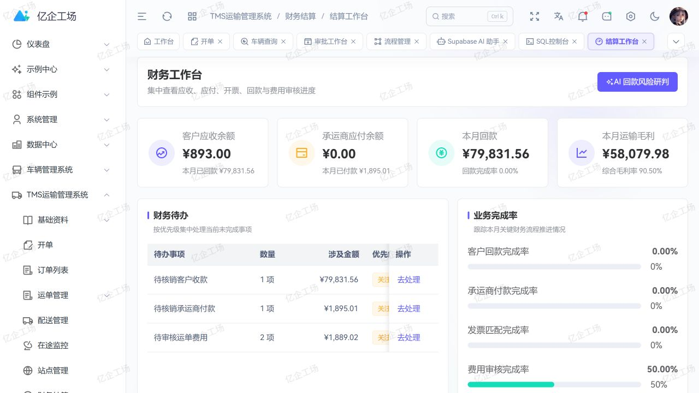

<div align="center">
  <h1>亿企工场 FMS</h1>
  <p><strong>面向运输与企业经营的一体化财务管理应用</strong></p>
  <p>把业务结算、资金收付、会计核算、票税资产与经营分析连接成可追溯的财务闭环。</p>

  <p>
    <a href="https://gitee.com/art-si/art-supabase-fms">Gitee</a>
    ·
    <a href="https://github.com/art-si/art-supabase-fms">GitHub</a>
    ·
    <a href="https://gitee.com/art-si/art-supabase-pro">主平台</a>
    ·
    <a href="https://art-si.github.io/art-supabase-doc/modules/fms">使用文档</a>
  </p>
</div>

## 项目定位

亿企工场 FMS 是亿企工场的财务管理业务应用。它不是孤立的财务页面集合，而是以运输单据和企业经营活动为来源，覆盖结算、资金、核算、报表与高风险反向操作治理。

本仓只维护 FMS 页面、业务 API、领域类型与适配代码。登录、租户、菜单、权限、布局、路由、公共组件、Store 和 Supabase 公共客户端由 [`art-supabase-pro`](https://gitee.com/art-si/art-supabase-pro) 统一提供。



## 核心能力

| 领域     | 已覆盖能力                                                                 |
| -------- | -------------------------------------------------------------------------- |
| 运输财务 | 客户/承运商对账、应收账龄、收付款、发票、运单费用、利润分析                |
| 资金管理 | 资金账户、资金日记账、账户调拨、现金预测、银行对账、付款申请               |
| 会计核算 | 账套与期间、科目、辅助核算、币种汇率、期初余额、凭证、自动入账、账簿与报表 |
| 专项财务 | 费用报销、商业票据、税务、固定资产、薪资、期末结账与异常中心               |
| 智能辅助 | 发票/票据 OCR、费用识别、合规复核、回款风险建议与核算准备检查              |

## 业务闭环

```text
运输与经营单据
  → 对账 / 应收应付 / 费用
  → 收付款 / 核销 / 发票
  → 凭证草稿 / 审核 / 过账
  → 账簿 / 报表 / 期末结账
  → 经营分析与异常治理
```

OCR 与 AI 只提供可复核的录入和分析建议；付款、过账、结账、反结账等高风险动作仍由有权限的人员确认，并由服务端权限与审计边界约束。

### 多账套自动入账约束

资产、折旧批次、薪资批次、税务期间和商业票据的入账事件继承来源记录的账套。服务端从对应业务表读取账套并验证租户一致性，不接受事件载荷指定的任意账套；缺失或跨租户来源必须拒绝。其他未明确归属账套的业务来源沿用租户默认账套规则。

2026-10-03 已通过正式重试接口验证两条资产转固和两个折旧批次：分别生成借贷平衡的两条分录，金额为 1200、2400、60、60。账套继承与跨租户拒绝经过事务回滚验证，内部解析函数仅授予数据库所有者执行权限。此记录仅证明该流程，不代表整个 FMS 的增删改查验收完成。

### 薪资流程验收记录

2026-10-03 使用业务账号在浏览器中为草稿验收批次新增两条员工明细，并编辑其中一条；批次自动重算为两名员工、实发合计 31。另一验收批次完成审批及发放，实发 280，资金日记账登记一笔同额支出。计提和支付事件分别生成借贷平衡的 355、280 两张凭证，两张凭证均已通过页面审核及过账；应付工资明细账包含支付借方 280、计提贷方 280，期末余额为 0。资金记录与薪资来源的租户、账套一致性检查无异常。

执行前已备份批次、明细、资金账户及关联记录，并通过回滚事务验证审批和发放。草稿批次通过引用检查后实际删除一条明细，并从新增页面恢复第二条明细。已验证桌面和窄屏详情展示、发放后明细锁定；全模块增删改查验收仍需逐项完成。

### 人人费用还款单

还款单以 `fms_travel_repayment` 为主单、`fms_travel_repayment_item` 为关联借款明细、`fms_travel_repayment_receipt` 为不可覆盖的逐笔收款流水。关联借款必须已付款；服务端锁定借款行后，由 `app_private.fms_travel_loan_settlement` 按已付款、实际收款、已审核抵扣及已提交未结算预留计算余额，草稿不占用额度，提交时重新校验。借款展示缓存由同一结算口径刷新；分次收款只预留未收部分，避免重复扣减。同一借款明细可拆分多笔归还，但合计不得超过该明细原借款金额。当前借款金额字段以人民币元计，明细币种与本位币均为 CNY、汇率为 1；引入多币种借款时必须同步调整来源字段和校验，不得只开放前端币种输入。

还款草稿由 `save_fms_travel_repayment_draft_entry_secure` 保存；内部三参数函数不授予 `authenticated` 执行权限。提交接口原子地校验余额并启动 `fms_travel_repayment` 审批实例，未发布审批定义时保留草稿。审批回调将单据推进到已审核或已驳回；确认收款按金额写入流水，并更新还款单已收款额及借款已还款额、未还余额。业务表向浏览器只授予读取，写入需通过带租户和按钮权限校验的 RPC。删除仅允许草稿，并经 `MasterDataDeleteGuard` 检查引用。

借款付款经 `record_fms_travel_loan_payment_secure` 校验审批状态、租户、按钮权限、收款明细、资金账户、金额上限和幂等请求标识。真实付款写入资金日记账；演示付款仅允许明确标识的测试收款账户与界面验收资金账户，付款记录标为 `is_demo`，不生成真实资金流水。演示借款只能走演示付款；关联的还款与收款也沿用演示标识。

2026-10-21 在目标租户发布借款和还款的“管理员初审 → 财务负责人复核”演示流程，并为财务主管开通对应账号与角色。借款 `JK202610-001`、`JK202610-002` 完成两级审批和模拟付款，金额分别为 ¥600、¥650。关联还款 `HK202610-001`、`HK202610-002` 完成两级审批和模拟收款，金额分别为 ¥250、¥300；两笔借款余额均为 ¥350。四张演示单据的首级及财务复核由平台管理员按审计规则代办，均记录实际操作人、原审批人和原因。付款与收款记录均标记 `is_demo`，没有生成真实资金流水。

`tests/integration/fms-travel-loan-payment.sql` 以回滚事务验证模拟付款幂等、金额上限、测试账户限制与资金流水隔离；`tests/integration/fms-travel-repayment.sql` 以回滚事务验证草稿编辑、超额拦截、已发布流程启动、审批回调、分次收款、租户范围和报销抵扣。真实资金付款与银行入账没有在演示流程中执行。

费用报销详情通过 `tms_get_expense_reimbursement_secure` 返回经过权限与租户范围校验的 `tenant_id`，编辑表单不再直读底表。真实报销付款按运单或差旅来源检查对应按钮权限；标记为 `is_demo` 的单据、`TEST-%` 收款账户和标为“不可用于实际付款”的银行一律拒绝真实付款。演示付款通过 `record_fms_travel_reimbursement_demo_payment_secure` 检查租户、按钮权限、审批状态、测试收款账户、界面验收资金账户、金额上限及幂等标识；付款记录标为 `is_demo`，资金流水和费用记账触发器均跳过演示记录。`tms_expense_payment` 对浏览器角色只开放读取，写入须经服务端付款接口。财务负责人角色获授该租户费用报销的查看、付款和模拟付款按钮。

2026-10-21 差旅报销 `FYBX202610-0005`、`FYBX202610-0006` 分别登记 2 笔和 1 笔费用，完成“财务负责人 → 出纳”审批和 ¥500、¥240 的模拟付款。四次审批由平台管理员留痕代办。两笔付款没有生成真实资金流水或费用记账事件。审批资料已按差旅明细计算费用笔数并指向新的人人费用详情路由；审批通过时，如未单独核定，主单及明细的核定金额默认采用申请金额。回滚测试见 `tests/integration/fms-reimbursement-detail-tenant.sql`、`tests/integration/fms-reimbursement-test-payee-guard.sql`、`tests/integration/fms-travel-reimbursement-demo-payment.sql` 和 `tests/integration/fms-reimbursement-approved-amount.sql`。真实资金付款与银行入账未在演示流程中执行。

2026-10-22 修复真实报销付款内部函数的租户解析：平台全部租户操作继承报销单租户，指定租户继续受当前范围约束；外部入口锁定主单后检查权限与账户，拒绝将界面验收资金账户用于真实付款。财务负责人已具备金额、收款资料、凭证的读取权限及付款执行字段的编辑权限。`tests/integration/fms-reimbursement-payment-scope.sql` 使用克隆单据和资金账户，在回滚事务中验证四笔分次付款、资金流水、平台全部/指定租户、财务本租户、伪造租户头、无付款权限拦截及内部函数不可直接调用；测试后未遗留克隆单据或账户。

同日内置浏览器恢复后，验证收款信息新增表单的员工参选与姓名工号回填，以及借款单按明细的合并单元格、专注模式进入和可见按钮退出。以上记录仅证明已列出的流程与状态，其他页面和付款弹窗的完整视觉验收继续逐项核对。

借款单列表补齐整单复制、单张/批量删除及批量打印。复制保存通过专用接口检查复制、新增权限和源单租户，生成独立编号与明细，保留演示标识但不复制付款历史。删除使用 `MasterDataDeleteGuard` 和专用关联查询，列出付款、还款、报销及审批历史；受保护的报销底表不直接开放给浏览器。无权查看的关联资料只提示存在关联，有权查看时提供单号、状态和相应导航。服务端只删除无业务引用的草稿，混合状态批次整体回滚。`tests/integration/fms-travel-loan-actions.sql` 以 authenticated 角色验证复制的四类租户范围、子表独立性、演示隔离、关联检查与批量删除原子性。浏览器已验证批量栏样式和打印入口返回；纸张布局、复制弹窗及后续下推场景继续验收。

## 独立运行

环境要求：Node.js `>= 22.0.0`、pnpm `>= 11.9.0`。

```powershell
pnpm install
pnpm dev
```

默认访问 `http://localhost:3012`。独立运行时，FMS 菜单提升为一级入口；由主平台装载时仍保留 FMS 应用分组。

```powershell
pnpm check
pnpm build
pnpm preview
```

生产构建输出到 `docs/`，默认公共路径为 `/art-supabase-fms/`，可作为 Pages 发布目录。

人人费用的十张收款、申请、借款及还款相关表已补齐统一审计字段和创建/修改触发器，租户默认值从认证账号解析；业务接口仍显式继承单据及父记录租户。历史子表缺失的操作人不回填猜测值，新增的修改时间初始化为升级时间。验证见 `tests/integration/fms-everyone-expense-audit.sql`；借款复制、模拟付款、还款审批与分次收款、报销模拟付款均已在补齐触发器后通过事务回滚验证。

复制借款弹窗的申请人、主职、当天申请日期、新还款日期、借款及收款明细已在真实浏览器核对；768px 窄屏下的批量栏、操作列与内部表格滚动正常。复制预览关闭后仍保留原有两张演示单据。借款下推与报销抵扣的完整入口、打印纸张布局仍需后续完成和验收。

## 2026-10-22 借款抵扣与差额结算验收

借款列表的下推菜单分别检查源单下推权限和目标单据查看、新增权限。目标页面重新读取可用余额、带入费用与收款明细，并在消费入口后清理 `fromLoan` 参数，刷新页面不会重复打开草稿。差旅报销继续使用与运单费用相同的 `tms_expense_reimbursement` 主表；借款抵扣、费用明细、收款明细按关联表管理。项目费用开关开启后项目仍为选填，与需求一致。

差旅付款统一通过 `record_fms_travel_reimbursement_payment_secure` 处理真实或演示付款，按主单现金差额及所选收款人剩余金额双重限额，幂等校验包含收款人、金额、日期、资金账户和演示标识。旧单收款人付款接口保留为兼容入口，运单付款继续通过同一底层记账引擎。内部插入及结算函数不授予浏览器角色调用。费用报销单编号默认每月三位流水；旧规则升级保留当月计数和历史编号。

演示流程新增 `FYBX202610-007`（报销 600、借款抵扣 350、模拟付款 250）、`FYBX202610-008`（报销 300、抵扣 300、无需现金付款），以及关联 `HK202610-003` 的 50 元模拟收款。两张源借款最终余额均为 0。审批由平台管理员留痕代办；新增付款及收款均为演示记录，核对真实资金流水和报销记账事件均为 0。还款审批通过时，未单独核定的金额默认采用申请金额；三张已验收演示还款补齐了该值。

回滚测试 `fms-travel-loan-settlement.sql`、`fms-travel-loan-push-scope.sql`、`fms-travel-repayment.sql` 使用隔离的借款样例，演示单结清后仍可重跑。另已通过净额多收款人付款、旧运单付款兼容、编号月切换、审批快照及字段权限等测试。新增前端代码通过 focused ESLint，UI 和共享复用审计通过，生产构建通过。早期全量 FMS 类型检查曾受并行工作的共享应付页面错误阻挡；后续交互复核时主仓和 FMS 类型检查均已通过。

实际浏览器已核对借款下推预填并保存报销、还款草稿，付款及收款弹窗的双列布局、完整流水号、零现金提示、列表明细合并、可见控件和 Esc 退出专注模式，以及深色与 768px 窄屏表现。三种打印组件使用实际模板与编译样式生成脱敏双单样例完成排版检查；原生打印纸张及设备输出未在内置浏览器中验证。截图与构建日志保存在忽略的 `.artifacts/fms-expense-features-20261019`。

### 人人费用交互复核

按用户反馈调整公共批量栏：操作紧跟选择数量靠左排列，表格工具仍在右侧；保留窄屏换行、专注模式和危险操作样式。收款信息写入时将可选员工、部门、费用承担公司和使用人字段的空字符串转为 `null`，隐藏的员工和使用人关联不继续提交。已在浏览器验证原有职员收款信息留空公司时保存成功，以及出差申请事由缺失时就地拦截、补回后保存成功。

五类主表草稿、新增或复制、借款与报销付款、还款收款补齐成功消息，只有后端成功后才反馈；原有审批公共入口继续负责提交消息，避免重复。删除成功消息由调用页面配置给公共删除钩子；删除成功后的列表刷新失败单独提示，避免误报删除失败。失败保存保留表单，取消删除不改变记录。

借款、报销、还款的单张和批量删除均重新读取状态，由 `MasterDataDeleteGuard` 展示受阻单号、状态、原因和可授权跳转；混合选择整体停止删除。关联读取失败仍停止删除并提供重试。三个专用读取接口处理收款资料、报销、还款的关联检查，展示父借款/报销单号或还款流水号；报销底表没有因此开放原始 `SELECT`。接口校验有效账号、按钮查看权限、普通用户本租户和平台全部/指定租户范围；没有关联查看权限时只返回阻断提示。业务删除接口与外键约束继续承担最终校验。

`tests/integration/fms-reimbursement-delete-inspection.sql` 与 `fms-expense-reference-inspection.sql` 已在回滚事务中验证全部/指定/本租户、伪造租户头、匿名拒绝、混合失效记录、单号、状态及跳转目标。交互复核的 focused ESLint、Stylelint、UI/复用审计、FMS 构建和 501 项单元测试通过；主仓首次默认内存检查退出，采用项目 8GB 配置后通过。验证资料保存在忽略的 `.artifacts/fms-everyone-interactions-20261022`。

## 2026-10-22 应收款目录贯通与交互复核

范围覆盖暂估应收、财务应收、收款、收款退款、收款核销工作台、收入成本确认、应收汇总与账龄、应收付款申请，以及关联编辑、复制、调整、勾稽、来源参选、删除检查、凭证和打印入口。沿用已标记的常用线路等现有页面与 Art 组件，保留工作区标题、副标题、右侧主要操作、查询按钮组、专注模式和表格内部滚动。批量操作紧随选择数量靠左排列；窄屏查询项为横向单据/明细切换预留宽度。

修正内容包括：复制使用独立请求标识与新编号；持久化明细删除先检查整单引用；来源参选使用受保护的数据解析回显；勾稽在服务端筛选后分页，排除冲回、异币种和已用尽来源，清空来源同时清空旧映射；核销查验显示币种，确认前展示双侧金额及单号/行号；本月到期指标按贷方符号计算；收入成本确认重复下推返回原单，未知成本显示“成本待落实”；导出单据链接复用表格 link 契约，保留 Excel 单据编号。新增多行来源收款允许未收行填 0，仅保存正数分配，已有云端分配仍要求正数；现金来源币种正确继承。

跨页来源详情复用主平台 `useRouteDocumentDrawer`，由目标路由处理参数，避免缓存的其他应收页抢先消费 `recordId`；打开后清理参数并恢复完整列表。没有新增独立路由详情框架。

### 演示数据与实际流程

所有新增应收页面的数据位于独立的 **FMS应收验收租户**（`fms-ar-qa-20261022`）。未修改实际公司的期初余额确认，也未连接银行。每个新增业务页面至少保留两条合成记录；报表、核销与来源参选使用这些关联记录，不造独立无来源的汇总数字。

- 两组运输来源分别完成暂估 1000/2000、财务应收、自动暂估冲回、收入成本确认（成本 400/800）、确认收款 600/1200、退款及付款申请 50/100。
- 两组先开票来源分别完成 100/200 的后续勾稽，生成对应冲回单及 source_match 审计记录。
- 两张财务应收生成借贷平衡的测试凭证草稿，金额 1000/2000；没有审核、过账或银行转账。
- 两条独立待分配收款 50/100、两条手工核销方案及各类可编辑草稿用于重复交互验证。多行财务应收 `AR-F-202610-003` 下推的 `AR-RC-202610-007` 已在浏览器保存，仅保留第二行 53 的分配，第一行占用为 0。
- 当前账龄汇总的财务应收净余额为 1332，暂估剩余为 0；草稿收款占用不扣减未核销余额。资金日记账仅为独立验收账套的合成记账，不能作为真实银行付款证明。

### 验证证据与边界

回滚验证覆盖生命周期、收款退款、核销/反核销、凭证、来源发票、明细余额、幂等、全部/指定租户、本租户及伪造租户头；测试夹具通过返回的记录 ID 隔离。九项基础集成测试共同运行通过；先开票勾稽测试独立运行在 fixtures/lifecycle 后，避免权限拒绝测试在同一事务中的临时授权变更污染后续用例。独立双流程验收、创建人显示和到期指标测试通过。测试文件见主仓 `tests/integration/fms-receivable-*.sql`。

浏览器已验证七个表格页面进入专注模式、Esc 与可见控件退出；核销方案保存与空值提示、双方余额查验、普通/特殊核销确认摘要及双侧分录；应收草稿编辑保存、复制独立编号、受保护删除确认与取消；付款申请用途及来源详情；单据/明细列切换、批量栏、深色及窄屏状态。实际下载并读取财务应收 Excel，8 条单据编号均存在。源码检查与浏览器检查分别记录，不以接口通过替代视觉检查。

最终主平台复验确认：缓存的财务应收和退款页不会抢占对方的来源参数；付款申请打开对应退款详情后恢复完整列表；编辑应收的结算客户与付款客户正确回显。1024px 查询按钮组保持横向，页面无横向溢出。验收结束后恢复原边框偏好与浏览器尺寸，保留验收租户页面。

主仓及 FMS 类型检查、FMS 生产构建、46 项 FMS 单测、相关文件格式/ESLint/Stylelint、UI/复用/按钮权限审计通过。类型、构建及浏览器复验覆盖最终的公共路由钩子复用和参选回显修正。脱敏查询区截图及最终构建日志保存在忽略的 `.artifacts/fms-everyone-interactions-20261022`。

原生打印入口能够触发系统打印，但内置浏览器的原生打印预览会阻断自动化连接；纸张布局及设备输出未作为通过项。上游 TMS 的已审核成本为明确标识的合成夹具，本记录不代表完整 TMS 审批验收。完整账套初始化遇到平台管理员创建人的复合外键限制，已与本次应收流程分开记录，没有放宽约束或改动实际公司初始化。

## 与主仓协作

FMS 业务修改在本仓提交并推送，随后在主仓更新 `modules/art-supabase-fms` 子模块指针。跨模块读取使用用途明确、字段最小化、租户隔离的 API/RPC 契约；FMS 不直接导入其他业务仓源码，也不复制主平台公共运行时。

## 安全原则

- 页面可见和按钮可用不代表后端授权，数据库 RLS 与服务端校验是最终边界。
- 制单、审核、过账、付款、核销、结账及反向操作应拆分权限并保留审计。
- 前端只使用 Supabase `anon` / publishable key，不暴露 `service_role` 或第三方服务密钥。

## 许可证

本项目采用 [MulanPSL-2.0](LICENSE) 许可证。
